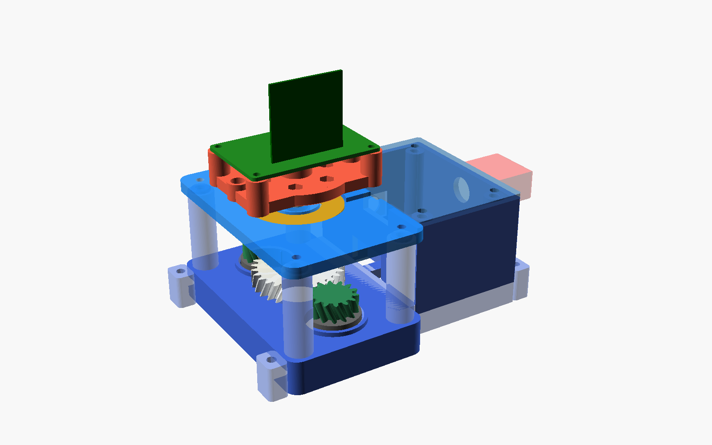
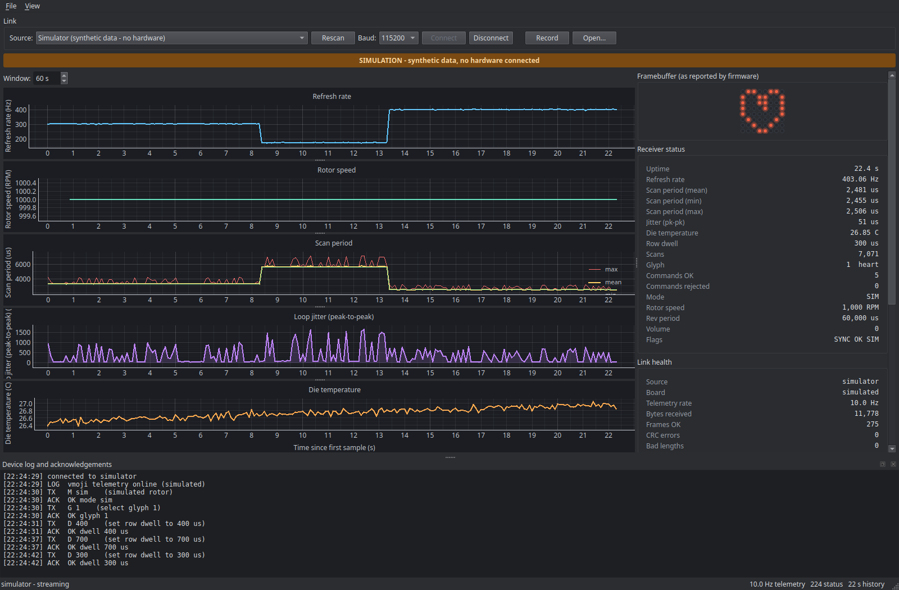

# vmoji

A small volumetric display built around a Raspberry Pi Pico (RP2040). An 8×8 LED matrix
spins on a motor-driven rotor and lights the right pattern at each angle, so a 3D shape
appears to float in the air (persistence of vision).



*The assembly as rendered from the OpenSCAD models. It gives a general idea of the
project but may not stay exactly accurate: the models in [`3D/`](3D) are the source of
truth.*

## Repository

| Folder | Contents |
|--------|----------|
| [`vmoji/`](vmoji) | Firmware: C/C++ on the Pico SDK |
| [`tests/firmware/`](tests/firmware) | Firmware logic tests that run on your PC |
| [`tools/dashboard/`](tools/dashboard) | Desktop telemetry dashboard (Python, PySide6) |
| [`3D/`](3D) | 3D-printable mechanics (OpenSCAD) |
| [`docs/`](docs) | Documentation |
| [`scripts/`](scripts) | Repo-wide helpers: `doctor.sh` (setup check), `check.sh` (all tests) |

## Quick start

vmoji is developed on **Linux** (Ubuntu / Linux Mint). Other systems may work but are
untested. First install the prerequisites: see [Getting started](docs/getting-started.md).

```bash
scripts/doctor.sh             # what is missing, and how to install it
vmoji/scripts/setup-sdk.sh    # Pico SDK (once)
vmoji/scripts/build.sh        # -> vmoji/build/vmoji.uf2
vmoji/scripts/flash.sh        # over USB
```

No hardware? The dashboard has a built-in simulator:

```bash
cd tools/dashboard
python3 -m venv .venv && .venv/bin/pip install -r requirements.txt
.venv/bin/python app.py --sim
```



Before committing, run `scripts/check.sh`.

## Documentation

| Guide | What it covers |
|-------|----------------|
| [Getting started](docs/getting-started.md) | Install everything, step by step |
| [Architecture](docs/architecture.md) | How the display works, end to end, and a glossary |
| [Firmware](docs/firmware.md) | Build, flash, test, and find your way around the code |
| [Commands](docs/commands.md) | The text commands the board accepts |
| [Telemetry](docs/telemetry.md) | The binary telemetry protocol |
| [Dashboard](docs/dashboard.md) | Running and extending the desktop dashboard |
| [Bring-up](docs/bring-up.md) | Checklist for a freshly flashed or assembled board |
| [Mechanics](docs/mechanics.md) | The OpenSCAD design: parameters, rules, checks |
| [Printing](docs/printing.md) | Exporting STLs, print settings, fit tuning |
| [Assembly](docs/assembly.md) | Parts list, assembly order, balancing |
| [Troubleshooting](docs/troubleshooting.md) | Common problems and their fixes |
