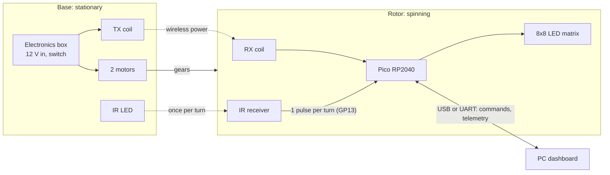
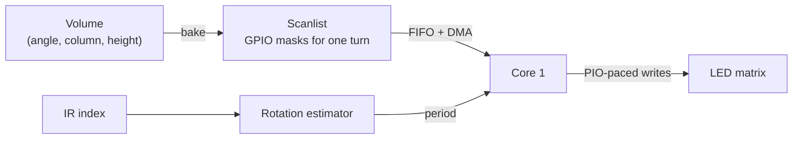

# Architecture

How vmoji turns a spinning LED matrix into a 3D image, from the motors to the dashboard.

## The big picture



- **Mechanics.** Two small motors drive the rotor through helical gears. The rotor turns
  on two 608 bearings. Details: [Mechanics](mechanics.md).
- **Power.** The rotor carries the Pico and the matrix. A TX coil in the base powers them
  wirelessly through an RX coil on the rotor, so there are no slip rings. That is also why
  no metal may sit in the gap between the coils.
- **Timing.** An IR LED on the base shines up at an IR receiver on the rotor once per turn.
  That pulse (the *index*) tells the firmware where "angle zero" is and how fast the rotor
  turns.
- **Host link.** A USB or UART cable carries commands to the board and telemetry back.
  There is no wireless data link, so the cable is for bench work with the rotor stopped or
  turned slowly by hand (or in simulation mode, below).

## How a 3D image is drawn

The matrix stands upright on the rotor. Its columns sit on either side of the spin axis
(from −radius to +radius) and its rows are height. As it turns, the matrix sweeps out a
cylinder.

Each turn is divided into angular *slices* (`ANGULAR_SLICES` in
[`geometry.h`](../vmoji/geometry.h)). For every slice the firmware lights the voxels that
belong at that angle. At around 1000 RPM a turn takes 60 ms, too fast for the eye, which
blends the slices into one solid image.

Outer columns sweep a longer path than inner ones, so they are lit longer to look equally
bright. The codec turns each slice into a fixed number of equal-length *mux steps* and gives
outer columns more of them ([`volume_codec.h`](../vmoji/volume_codec.h)). Every step lasts
the same time, so the scanner only has to know the step length:

```
step time = revolution period / steps per revolution
```

## Firmware

### Modes

| Mode | What it shows | Who scans the matrix |
|------|---------------|----------------------|
| `static` (boot default) | Flat 8×8 content: glyphs, scores, the pixel walk | Core 0, row by row |
| `pov` | 3D volumes, synchronised to the IR index | Core 1, paced by PIO |
| `sim` | Same as `pov`, with a simulated index at a fixed rate (`ROTATION_SIM_RPM`) | Core 1, paced by PIO |

Switch modes with the `M` command ([Commands](commands.md)). On power-up the board loops a
*boot demo*, a pixel walk that shows it is alive, until a host takes over the display.

### The two cores

**Core 0** runs one short loop ([`main.c`](../vmoji/main.c)):

1. advance the boot demo, if it is running;
2. scan the matrix (static mode) or service the POV state machine (pov/sim);
3. read commands from USB and UART;
4. send telemetry;
5. kick the watchdog.

**Core 1** only scans in pov/sim mode. It waits for core 0 to signal a new turn, then plays
that turn's list of GPIO masks. A PIO state machine paces each step to the cycle, so
command handling on core 0 can't disturb the timing.

### The POV pipeline



- **Volume** ([`volume.h`](../vmoji/volume.h)): the content, as on/off voxels per slice.
  It is double-buffered, so core 0 can prepare the next image while core 1 shows the
  current one. Built-in volumes live in `volumes_builtin.c`.
- **Bake** ([`volume_codec.h`](../vmoji/volume_codec.h)): converts a volume into the list
  of GPIO masks for one turn.
- **Scan** ([`pio_scan.h`](../vmoji/pio_scan.h)): applies the masks with the step length
  derived from the measured period.
- **Rotation** ([`rotation_sync.h`](../vmoji/rotation_sync.h)): the IR edge interrupt,
  a debounce that ignores contact noise ([`ir_debounce.h`](../vmoji/ir_debounce.h)), and a
  smoothed period estimate ([`rotation_estimator.h`](../vmoji/rotation_estimator.h)). With
  no index pulse for a while, sync is declared lost and the display blanks.

### Talking to a host

USB (CDC serial) and UART0 carry the same traffic:

- **Commands** go to the board as short text lines, so you can type them by hand:
  [Commands](commands.md).
- **Telemetry** comes back as compact binary frames with a CRC (scan timing, rotor speed,
  temperature and more): [Telemetry](telemetry.md). The [dashboard](dashboard.md) plots it.

### Built to be tested on a PC

The logic (command parsing, the POV state machine, the codec, rotation estimation, the boot
demo) has no Pico SDK dependency, so [`tests/firmware/`](../tests/firmware) compiles the same
sources on your PC with fakes for the hardware. How that stays true:
[Firmware](firmware.md#conventions).

## Glossary

| Term | Meaning |
|------|---------|
| POV | Persistence of vision: the eye blends fast-changing images into one. |
| Voxel | A 3D pixel: one LED at one angle. |
| Slice | One angular sector of a turn; the matrix shows one slice at a time. |
| Volume | A full 3D image: every slice of one turn. |
| Index | The once-per-turn IR pulse that marks angle zero. |
| Sync loss | No index pulse for too long; the display blanks rather than smear. |
| Mux step | One time step of the scan: one column lit, with its rows' pattern. |
| Scanlist | The baked list of mux steps (GPIO masks) for one turn. |
| Row dwell | In static mode, how long each row stays lit (the `D` command). |
| Boot demo | The pixel walk the board loops from power-up until a host takes over. |
| Activity pixel | The bottom-right LED, which blinks after `H` or `S` in static mode. |
