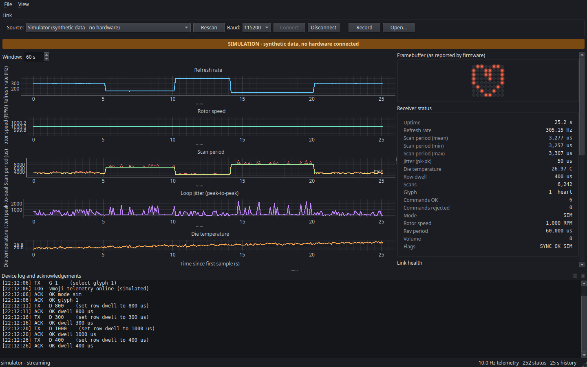

# Dashboard

A desktop app ([`tools/dashboard/`](../tools/dashboard)) that plots the firmware's
[telemetry](telemetry.md) live, sends commands, records sessions and replays them.



The steps in the refresh-rate plot are row-dwell changes sent from the control panel: a
longer dwell lowers the scan rate, and the scan period moves the other way. Turning "the
display looks dim" into numbers is what the tool is for.

Setup: [Getting started](getting-started.md#4-dashboard-a-python-virtual-environment).
All commands below run from `tools/dashboard`.

## Run

```bash
.venv/bin/python app.py                       # find a board; fall back to the simulator
.venv/bin/python app.py --sim                 # simulator, no hardware
.venv/bin/python app.py --port /dev/ttyACM0   # a specific port
.venv/bin/python app.py --replay session.vmc  # replay a recording
.venv/bin/python app.py --help                # every option
```

Ctrl+C in the terminal closes it like the window's close button, so a recording is finished
and saved.

- **Finding the board.** Ports are ranked by USB id (the Pico itself, then a Debug Probe's
  UART), and a port must deliver one valid frame before the dashboard trusts it. With no
  such port it says why in the terminal (including a board stuck in BOOTSEL) and falls back
  to the simulator. A dropped link reconnects on its own, and new ports show up within two
  seconds.
- **No silent simulation.** The simulator always shows a **SIMULATION** banner and a
  title-bar marker. With real hardware, *Link health → Board* shows the chip id.
- **Recording.** *Record* writes a `.vmc` capture: the raw bytes with host timestamps, so a
  fixed parser can re-read old sessions, corrupted frames included. Replays get play,
  pause, seek, loop and speed controls.

### No display

The app needs a graphical session. Without one (SSH, a container) it says so and exits. The
alternatives, with `sudo apt install xvfb` for the first:

```bash
xvfb-run -a .venv/bin/python app.py --sim                # a virtual display
QT_QPA_PLATFORM=offscreen .venv/bin/python app.py --sim  # no window at all
```

`verify_link.py`, `walk_pixels.py` and the tests need no display.

## What it shows

- **Plots:** refresh rate, rotor speed, scan period (min/mean/max), loop jitter, die
  temperature, all on one time axis.
- **Receiver status:** every Status field, including mode, rotor speed and flags. Rotor
  speed shows only while the IR index is locked (`SYNC OK`); otherwise it reads "no sync".
  Values that signal trouble are highlighted (rejected commands, data-loss flags, lost sync
  in POV mode, a stale link).
- **Link health:** CRC errors, sequence gaps and other counters, always visible, so you
  know when not to trust a plot.
- **Control:** glyph, row dwell, heartbeat, blank, pause, reset counters, query.
- **Pixel walk:** lights each LED alone to check the soldering. Step with Prev/Next or
  *Auto*, score each LED 0–5 with the buttons or the number keys, then *Export CSV*
  (row, column, both GPIOs, score). Untoggling *Start* blanks the display. A dim LED in the
  walk points to the LED or its joints; dim only with the full matrix lit (`G 5`) points to
  the row's current.

## Command-line tools

```bash
.venv/bin/python verify_link.py --port /dev/ttyACM0                # is the link healthy?
.venv/bin/python verify_link.py --port /dev/ttyACM0 --command "?"  # send one command
.venv/bin/python walk_pixels.py --port /dev/ttyACM0 --step         # pixel walk, Enter to advance
```

`verify_link.py` checks the numbers, not just that bytes arrive: a low telemetry rate, a
zero refresh rate, an implausible temperature, too many CRC errors, or jitter beyond the
scan period each fail with a one-line reason (exit code 1). Without `--port`, both tools
run against the simulator.

## Test

```bash
.venv/bin/python -m pytest tests -q
.venv/bin/ruff check .
```

No hardware needed: serial is exercised over a pseudo-terminal. `scripts/check.sh` runs
both.

## How it is built

```
SerialSource / SimSource / ReplaySource
        │
        ▼
ReaderWorker (QThread) ──queued signal──▶ TelemetryModel (bounded) ──QTimer 30 Hz──▶ views
        │
        └──▶ CaptureWriter (.vmc)
```

- **The reader thread never touches a widget.** It parses on its own thread and hands
  messages over by Qt signal, so the UI never blocks on serial.
- **Data rate and frame rate are independent.** Messages land in the model as they arrive;
  the screen repaints at a fixed 30 Hz.
- **Every buffer is bounded**, so the app can run for days.
- **One dark theme.** Every color lives in `theme.py`, whatever the desktop's theme is.
- **Most of the code is Qt-free and tested with plain pytest:** the parser
  (`protocol.py`), the sources (`sources.py`), the model, the readout formatting
  (`panels.py`), reconnect and the pixel walk logic. The Qt layer (`main_window.py`,
  `widgets.py`, `reader.py`) is kept thin.

### Adding a readout or plot

- **A readout row:** add an entry to `STATUS_SPECS` (or `LINK_SPECS`) in `panels.py`, then
  a test in `tests/test_panels.py`. The window picks it up automatically.
- **A plot:** add a `Series` in `model.py`, then a `_make_plot` call in
  `MainWindow._build_plots` and a `setData` line in `_repaint`.
- **A new Status field:** follow [Telemetry: changing the format](telemetry.md#changing-the-format)
  first.
